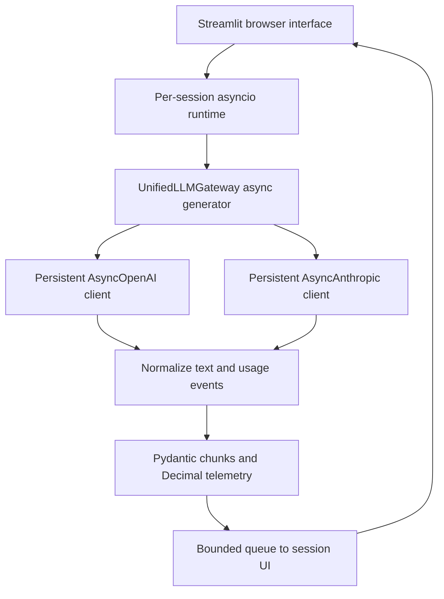

# Relay — Multi-Provider LLM Gateway

An asynchronous Python 3.11+ gateway for OpenAI and Anthropic, with normalized
Pydantic v2 streaming events, live telemetry, deterministic Decimal cost accounting,
a Streamlit web UI, typed errors, and credential-redaction tests.

**Windows quick start: [START_HERE.md](START_HERE.md).**

```powershell
uv sync --frozen
uv run streamlit run src/app.py
uv run pytest -v
```

The default interface is **live mode** and needs the selected provider's key.
A visibly labeled offline fixture preview is also available, but does not prove
live LLM streaming. Provider credentials stay on the server; there are no API-key
inputs in the browser. Both live providers must be demonstrated for the rubric.

## Architecture



`UnifiedLLMGateway.stream(prompt, model, temperature=0.7, max_tokens=512)` yields
`StreamChunk` objects. Each contains `delta_text`, `provider`, `model`, `is_final`,
`mode`, and `telemetry`. Deltas can contain multiple tokens. Exactly one final
chunk is emitted on normal completion; errors never masquerade as success.

Provider objects are hidden from application consumers. Pure normalization lives
in `src/normalization.py`. `src/runtime.py` bridges Streamlit's synchronous session
thread to a persistent asyncio event loop using a bounded queue. Blocking queue
polling is confined to the Streamlit thread, never the provider event loop.
SDK clients are lazy, connection-pooled, and reused for multiple requests on that
same loop. Session runtimes expire after 15 idle minutes and close their clients.
Key/mode changes close the old gateway. There is no shared user conversation state.

The gateway supports concurrent calls with independent request-local metrics.
The UI allows one active request per session. Cancel/clear or a rerun releases the
consumer, cancels its task, and closes the upstream stream via `aclosing`.
Local tokenization runs with `asyncio.to_thread` so CPU work and initial tokenizer
asset loading do not block the provider loop.

## Environment and credentials

Install [uv](https://docs.astral.sh/uv/getting-started/installation/), then
`uv sync --frozen`. uv uses the Python 3.11 pin and locked dependency versions.
Create `.env` from `.env.example` and configure your own keys:

```dotenv
OPENAI_API_KEY=your-secret-openai-key
ANTHROPIC_API_KEY=your-secret-anthropic-key
```

These are examples only. Store real values locally in `.env` or the host's secret
manager. Both `.env` and `.streamlit/secrets.toml` are Git-ignored and Docker-ignored.
The selected provider alone needs a key; the other provider remains selectable
and reports a typed missing-key error if unconfigured.

Keys are `SecretStr` values excluded from settings serialization and repr.
Only fixed actionable domain error messages reach the UI. SDK response bodies,
exception messages, HTTP headers and credential values are not included. Requests
use fixed official API origins, avoiding environment-variable base-URL redirects.
No key is sent to a language model as prompt text. Do not enable raw SDK/HTTP debug
logging. The redaction filter protects gateway logger messages; it is not a claim
that arbitrary third-party code or your own new log statements are secret-proof.

No authentication or per-user spending quota is implemented. Keep hosted access
private while funded keys are configured, or remove server keys after evaluation.
Prompt/response downloads may contain user-provided sensitive content; no server
prompt history or log file is written. Up to ten live comparisons are retained
only in the current Streamlit session.

## Models and standard USD pricing

Rates verified against primary documentation on **2026-10-28**; stored in
`src/pricing.py`. This is a static, versioned table, not a live billing feed.

| Model ID | Provider | Input / 1M tokens | Output / 1M tokens | Cached input read / 1M |
| --- | --- | ---: | ---: | ---: |
| gpt-4o-mini | OpenAI | $0.15 | $0.60 | $0.075 |
| gpt-4o | OpenAI | $2.50 | $10.00 | $1.25 |
| claude-haiku-4-5-20251001 | Anthropic | $1.00 | $5.00 | $0.10 |
| claude-sonnet-4-5-20250929 | Anthropic | $3.00 | $15.00 | $0.30 |

For Anthropic, 5-minute cache writes are 1.25× base input and 1-hour writes are
2× base input. The app does not request prompt caching, tools, extended thinking,
batch or priority processing. The normalizer and calculator still handle cached
usage metadata. Input classes are mutually exclusive in the cost formula.
OpenAI requests explicitly use the default service tier.

Older Claude 3.5 names in the assignment are examples; this project selects
currently documented 4.5 text models with matching price entries. Check provider
availability for your account before recording. There is no silent model fallback.
If you add a model, add its verified pricing and any required parameter differences.

## Token and cost accounting

- **Live estimates:** `tiktoken`'s `o200k_base` counts cumulative prompt/output
  text; estimates are recomputed over the full generated string instead of
  summing separately tokenized chunks. OpenAI input estimates include a documented
  seven-token chat-framing approximation. Anthropic uses its own tokenizer, so
  tiktoken is only a local display proxy for that provider.
- **OpenAI final usage:** `stream_options={"include_usage": True}` requests the
  usage-only tail. Empty `choices` and `None` content do not crash the parser.
  Cached input is already included in OpenAI `prompt_tokens`.
- **Anthropic usage:** `message_start` supplies input categories. `message_delta`
  output counts are cumulative and REPLACE the previous count. `message_stop`
  confirms normal stream completion. Cache categories are added to its uncached
  input count to produce a cross-provider total-input field.
- **Authority:** before final usage, metrics explicitly say `local_estimate` or
  `provider_partial`. Final usage becomes `provider_final`. If a completed stream
  lacks final usage, the final chunk is labeled `estimate_missing_final_usage`,
  with a warning. An interrupted stream raises `IncompleteStreamError` and does
  not emit a final success chunk. These are different cases.
- **Cost:** exact Decimal arithmetic, no binary float accumulation. The displayed
  value has six decimal places (microdollars); downloads retain the unrounded
  value, including sub-microdollar values. Six decimal USD places are not the
  same as one-millionth of a cent. Monetary display rounding never modifies
  internal calculation precision.

For uncached standard text:

`cost_usd = (input_tokens × input_rate + output_tokens × output_rate) / 1_000_000`

The live number is a **per-request calculation using listed rates**, not a receipt
or account balance. It can decrease when provider totals replace local estimates.
A partial interrupted response may already have incurred provider charges, and
its displayed cost may underestimate final billed usage.

## Timing definitions

- **TTFT:** monotonic time from API dispatch to the first non-empty text delta,
  including network and provider processing. Role-only, empty and usage-only
  events do not set it. Local tokenizer/key preflight occurs before this timer.
- **Total latency:** elapsed time from API dispatch through received stream end,
  including client parsing and backpressure, not a pure server inference metric.
- **Generation speed:** output tokens divided by elapsed time since first text,
  with a 1 ms lower bound; it includes tail usage delivery and consumer overhead.
  Short responses and the first chunk have unstable estimates.
- **Empty text responses:** TTFT remains absent and throughput zero; no invented
  timing or token counts are substituted. Output-limit endings show a truncation
  warning. A delta is not necessarily a single token.

## Error and request boundaries

Typed errors: `AuthenticationError`, `RateLimitExceededError`,
`GatewayConnectionError`, `InvalidRequestError`, `IncompleteStreamError`, and
`GatewayProviderError`. SDK authentication, rate-limit, connection/timeout and
request failures are mapped without exposing their raw body. HTTP 429 can be a
rate limit or account quota; check account details before retrying.

SDK retries are disabled. Streams are not automatically restarted, preventing
silently duplicated partial output or extra requests. Prompt size is limited to
20,000 characters, the common temperature range is 0–1, and output is capped at
2,048 tokens in the API (1,024 in the UI). Each stream has a 90-second overall
budget in addition to the SDK's 45-second network timeout.

## Tests

```powershell
uv run pytest -v
```

Default tests require no keys and make no billable calls. They include:
normalized streams for both providers; 50-word local-token counting with explicit
chat overhead; Decimal costs and caches; first-text timing; missing usage;
truncation; cancellation and resource cleanup; concurrent requests and event-loop
responsiveness; client reuse; typed/redacted provider failures; real SDK SSE
parsing through HTTPX MockTransport; session-runtime reuse; and Streamlit widget flows.

The fixed usage values in mocks test integration/accounting; they do not prove
that a live provider's tokenizer agrees with tiktoken. Chat wrappers can exceed a
10% difference for short prompts; raw-text local counts are shown separately.

Two live smoke tests are skipped by default. To opt in (BILLABLE):

```powershell
$env:RUN_LIVE_TESTS = "1"
uv run pytest -v -m live
Remove-Item Env:RUN_LIVE_TESTS
```

Use the same short prompt in both live providers in the UI for your video.
See [QA_REPORT.md](QA_REPORT.md) for exactly what was and was not verified.

## AI audit and before/after evidence

`ai_prompt_log.md` records AI assistance and the technical review. A retained
minimal event-handling example demonstrates two normalization flaws: indexing an
empty OpenAI choices list and summing cumulative Anthropic output snapshots.

`audit/baseline_probe.txt` records the observed failures.
`audit/normalization.diff` compares the saved example with the final normalizer.
Regression tests reproduce the failures and verify the corrections. The audit
also covers async blocking, client reuse, token framing, and cancellation. A
manual-review section is provided for local findings and execution evidence.

## Deployment

### Streamlit Community Cloud

Push this folder's contents into a separate repository and select `src/app.py`,
branch `main`, Python 3.11. Both `uv.lock` and pip-compatible `requirements.txt`
are provided. Add the two credentials via **Advanced settings > Secrets**, using
`.streamlit/secrets.toml.example` as the format reference. Keep the actual secret
file out of Git. Check the host's logs if dependency installation fails.

### Docker alternative

```powershell
docker compose up --build
# In another terminal:
docker compose exec gateway python -m pytest -v
```

Open http://localhost:8501. Stop an existing invoice server using that port first.
Compose reads the API values from `.env`, binds only localhost and runs a non-root
container. Stop with `docker compose down`. Docker was unavailable in the build
environment; container build/run must be verified locally before claiming it works.

## Deliverables

- `START_HERE.md`: Windows setup and deployment steps.
- `VIDEO_SCRIPT.md`: plain-language 5–7 minute walkthrough with screen cues.
- `SUBMISSION_TEMPLATE.md`: fill in actual GitHub, deployment, and YouTube links.
- `QA_REPORT.md`: validation scope and outstanding live checks.

Live provider runs, deployment, and the video are remaining submission steps.
See `QA_REPORT.md` for completed checks. Production extensions would include
authentication, durable telemetry, per-user limits, and invoice reconciliation.

## Primary sources

- [OpenAI streaming reference](https://developers.openai.com/api/reference/resources/chat/subresources/completions/methods/create)
- [OpenAI GPT-4o mini rates](https://developers.openai.com/api/docs/models/gpt-4o-mini)
- [OpenAI GPT-4o rates](https://developers.openai.com/api/docs/models/gpt-4o)
- [Anthropic streaming events](https://platform.claude.com/docs/en/build-with-claude/streaming)
- [Anthropic pricing and cache rates](https://platform.claude.com/docs/en/about-claude/pricing)
- [Claude Haiku 4.5 model identifier](https://platform.claude.com/docs/en/models/haiku-4-5/overview)
- [Pydantic v2](https://docs.pydantic.dev/latest/)
- [Streamlit app testing](https://docs.streamlit.io/develop/api-reference/app-testing)
